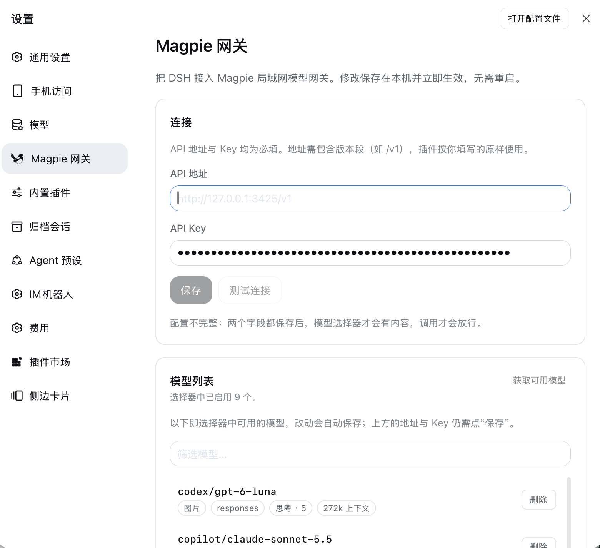

# dsh-magpie-connect

把 Magpie 网关上的模型接进 DeepSeek Harness（DSH）的模型选择器。

装好之后，你就能在 DSH 里直接选用网关提供的模型，不需要额外跑进程，也不用配代理。

<p align="center">
  
</p>

## 功能

- **模型自动同步** — 网关列出的模型全部进入 DSH 模型选择器，想显示哪些由你决定。
- **图片识别** — 网关声明支持图片的模型可以直接发图。
- **思考档位** — 网关支持的思考档位（含 `none`、`ultra`）原样出现在选择器里。

## 安装

```sh
dsh plugin --profile web add dsh-magpie-connect
```

安装后重启 `dsh web`。

已有安装用同一条命令即可更新到最新版本。

**需要**：DSH 的 web profile、Node.js ≥ 20、能访问网关。

## 使用

### 第一步：填网关地址和 Key

打开 **设置 → Magpie 网关**，确认两项：

- **API 地址** — 网关地址，**要带版本号**。默认已填好 `http://127.0.0.1:3425/v1`，网关不在本机时改成实际地址。
- **API Key** — 网关凭据，必填。

点「保存」后，可以点「测试连接」确认通不通（会告诉你网关上有多少模型）。两项都齐了才会生效——
地址有默认值，Key 没有，所以没填 Key 之前模型选择器是空的。

> **地址一定要带版本段**（如 `/v1`）。插件只在你填的地址后面接资源名，不会自己补
> 版本号——所以网关以后升级到 `/v2`、`/v3`，你只要改这一个字符串。

### 第二步：选择要显示的模型

点 **获取可用模型**，会弹出网关当前的模型列表：勾选你想要的，再点「应用选择」。
弹窗里可以搜索、全选、取消全选。

模型列表是**白名单**，和 DSH 自带的「模型」设置语义一致：列表里有什么，选择器就提供
什么。不想要的点该行末尾的「删除」，它就从列表和选择器里一起消失；想加回来，点
「获取可用模型」，在弹窗里勾上它再「应用选择」。

**新增的模型不会自己出现**：网关新上架的模型要你在弹窗里勾选并应用后才会进入列表。
这是白名单的代价，也是它的好处——网关某条 lane 抖动（临时掉线又恢复）不会把你删掉的
模型偷偷放回来。

**「恢复默认模型」**：清掉自定义列表，回到「直接使用网关的完整目录」。列表为空
（`[]`）和继承网关目录是两种不同状态：前者一个模型都不提供，后者全提供。

**「获取可用模型」会同步本地目录**：弹窗拿到的就是网关此刻的完整目录，读取成功后本地
目录整体替换成它，所以网关已下架的模型会同时从弹窗和列表消失；读取失败（地址错、
Key 无效、网关不通）不会清空本地目录，避免把选择器误清成空。

> 行末的 `内置快照` 标签说明这条来自插件的兜底快照（网关暂时不可达时），不是网关当前列表。

> 弹窗查的是**你当前填的地址和 Key**（哪怕还没保存），所以换网关是一趟的事。
> 连不上也不会卡住——失败原因会显示在列表下方，已列出的行仍然可以操作。

### 什么时候需要保存

- **地址和 Key**：点「保存」才生效。
- **模型增删**：**自动保存**，不用点任何按钮。

## 常见问题

**模型选择器是空的？**

先确认地址和 Key 都填了并且已经保存，再点「测试连接」。最常见的原因是地址缺了版本段
（比如填成 `http://127.0.0.1:3425`，而应该是 `http://127.0.0.1:3425/v1`）。

**删掉的模型怎么加回来？**

点「获取可用模型」，在弹窗里勾上它再「应用选择」。弹窗列出的是网关当前提供的全部
模型，勾选会**替换**整份列表——只想保留某几个，就只勾那几个。

**网关新加了模型，为什么列表里没有？**

白名单语义：新模型需要你在「获取可用模型」里勾选并应用后才会出现。

**从旧版本升级，我原来的删除记录还在吗？**

在。首次启动会自动把旧的 `hiddenModels`（黑名单）换算成 `enabledModels`（白名单），
并写回 `~/.dsh-magpie-connect/settings.json`，只执行一次。若升级时网关不可达、
算不出旧列表，则退回「继承网关目录」，不会误删你能用的模型。

**为什么我删掉的模型又出现了？**

不应该再出现：删除记录会原样保存（网关某轮没列出它也不会被忘掉），而「获取可用模型」
只改动它这次列出的模型。如果你在**旧版本**上删过模型，那份删除记录可能已被旧逻辑丢掉，
升级后重新删一次即可。

**网关下架了某个模型，列表里为什么还显示？**

现在不会了：点一次「获取可用模型」，本地目录就会同步成网关当前目录，下架的模型随之消失。
如果它仍显示，说明本地目录还停在旧快照上——看列表下方是否报了网关错误。

**改了网关地址，模型列表没变？**

保存后列表会重新拉取。如果新网关暂时不通，会先用本地缓存。

**页面提示「未配置」？**

地址和 Key 缺任意一项都会这样——此时选择器是空的，调用也会直接失败并给出提示。

**发图失败？**

只有网关声明支持图片的模型才能收图。如果给纯文本模型发图，会直接报错而不是静默丢弃。
另外，图片需要通过 harness 的附件服务读取，在没有该服务的组合里也会失败。

## 进阶用法

### 用配置文件代替设置页

除了设置页，也可以在 profile 的 `cordis.patch.yml` 里配置：

```yaml
- id: dsh-magpie-connect
  name: 'dsh-magpie-connect'
  config:
    providerId: dsh-magpie-connect
    displayName: Magpie
    baseUrl: http://127.0.0.1:3425/v1   # 带版本号的完整地址
    apiKey: not-needed           # 网关通常不校验，但必须非空
    refreshSeconds: 300
    maxRetries: 2
    timeoutMs: 300000
    firstEventTimeoutMs: 90000
    idleTimeoutMs: 60000
```

| 配置项 | 默认值 | 说明 |
| --- | --- | --- |
| `providerId` | `dsh-magpie-connect` | 注册到 DSH 的 provider 名称。 |
| `displayName` | `Magpie` | 模型选择器里的分组名。 |
| `baseUrl` | `http://127.0.0.1:3425/v1` | 带版本号的 API 地址。 |
| `apiKey` | `''`（未配置） | 网关凭据。必填，即使网关不校验——地址有默认值，Key 没有。 |
| `dataDir` | `~/.dsh-magpie-connect` | 状态目录（状态快照、设置文件、模型缓存）。 |
| `refreshSeconds` | `300` | 模型目录刷新间隔（秒）。 |
| `maxRetries` | `2` | 遇到 429/5xx 时的连接重试次数。 |
| `timeoutMs` | `300000` | 单次请求的总超时（毫秒）。 |
| `firstEventTimeoutMs` | `90000` | 等待首个上游事件的超时（毫秒）。 |
| `idleTimeoutMs` | `60000` | 上游事件之间的静默超时（毫秒）。 |

优先级：设置页 > `cordis.patch.yml` > 默认值。设置页只覆盖你保存过的字段。

### 工作原理

```
DSH 会话
   │  harness 数据块（block-start / text-delta / usage / finish …）
   ▼
MagpieAdapter（注册为 DSH 的 LlmAdapter）
   │  pi-ai openai-completions 流（默认）/
   │      openai-responses 流（仅支持 responses 的模型）
   ▼
http://127.0.0.1:3425/v1  ← 按 native_endpoints 选择 chat/completions 或 responses
```

- **模型目录** — 全量接入网关 `GET {baseUrl}/models`，不做付费过滤；磁盘缓存加编译期
  静态快照兜底，网关宕机时选择器仍可用。暴露集合一旦变化（隐藏/显示、换网关地址、
  刷新后模型增删），会发出 `llm/adapters-updated` 让浏览器重读缓存——否则选择器会
  一直显示旧列表直到下次重启。
- **思考档位** — 有档位阶梯的模型进入选择器；没有阶梯但可思考的模型保持可思考
  （显式档位直通网关）；`none` 关闭思考，`ultra` 直通网关，不在本地截断。
- **图片** — 带图的请求经 harness 附件服务取字节后上行；文本模型收到图片会直接
  失败（harness 已按模型声明的输入类型做过门控）。
- **容错** — 启动即注册，目录在后台预热；静默挂起会被看门狗快速判为超时；
  上游截断如实上报，不做自动续写。

运行状态快照写在 `~/.dsh-magpie-connect/adapter-status.json`，设置与缓存在同一目录。

## 开发

```sh
pnpm install
pnpm run check          # 类型检查 + 测试 + 构建
pnpm run deploy:local   # 构建并同步到 web profile
```

`lib/` 是提交进仓库的构建产物，所以 profile 安装时不需要现场构建。

发布由 `.github/workflows/release.yml` 负责：把 `package.json` 和
`dsh.plugin.json` 的版本号改成一致后提交推送，流水线会打 tag、建 GitHub Release
并发布到 npm。版本号带 `-`（如 `0.3.0-rc.1`）时自动标记为预发布。

## 许可证

[MIT](./LICENSE)
